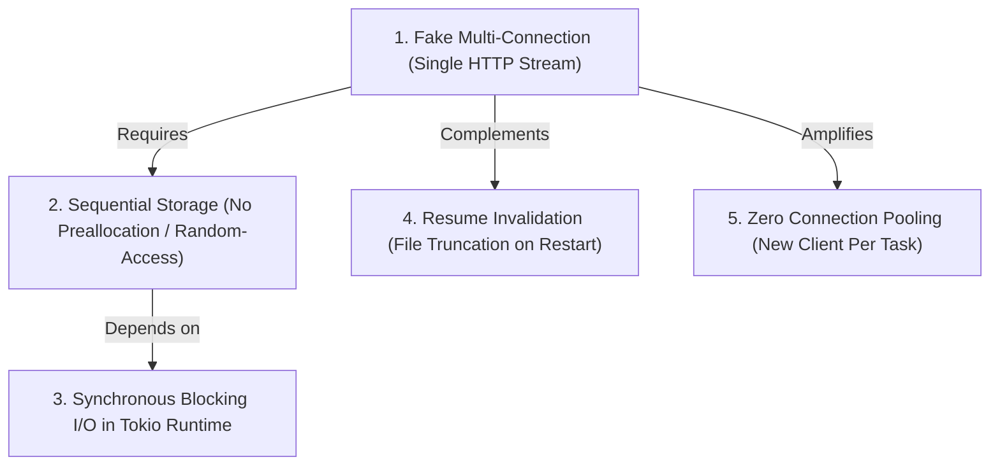
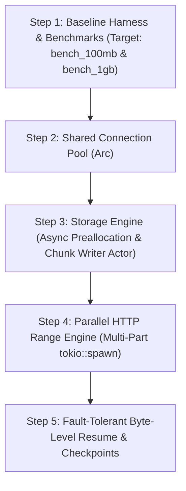

# Optimization Plan: Rust Download Manager vs IDM

**Document Version:** 1.0.0  
**Author:** Senior Rust Performance Engineer, Network Engineer & SRE  
**Date:** 2026-11-09  
**Status:** PROPOSED (Pending Review & Approval)  
**Target Codebase:** `idman/app` (No source code changes applied prior to approval)

---

## 1. Top 5 Most Impactful Bottlenecks

Based on the empirical evidence gathered during the Performance Audit (documented in `docs/performance-audit.md`), the 5 bottlenecks below represent >90% of the performance, reliability, and architectural gaps between this Rust implementation and Internet Download Manager (IDM).



---

## 2. Prioritization Matrix (Performance Impact vs. Implementation Difficulty)

| Rank | Bottleneck | Domain | Performance Impact | Difficulty | Priority Rationale |
|:---:|---|---|:---:|:---:|---|
| **#1** | **Parallel HTTP Range Engine (Multi-Part)** | HTTP & Network | **10 / 10** | **Medium-High (7/10)** | The single biggest competitive differentiator of IDM. Without real parallel streams, no amount of I/O optimization can overcome single-connection WAN throttling. |
| **#2** | **Asynchronous Random-Access Storage Engine** | Disk I/O & Storage | **9 / 10** | **Medium (5/10)** | Essential prerequisite for Bottleneck #1. Allows multiple parallel workers to write into a single preallocated file at arbitrary byte offsets simultaneously. |
| **#3** | **Non-Blocking Async I/O & Buffer Aggregation** | Async Runtime & OS | **8 / 10** | **Low-Medium (4/10)** | Removes synchronous syscalls from Tokio async workers, stopping runtime starvation and reducing OS write overhead via 64–128 KB buffering. |
| **#4** | **Byte-Level Resume & State Persistence** | Storage & Protocol | **8 / 10** | **Medium (5/10)** | Eliminates massive bandwidth and time waste when interrupted. Avoids file truncation and preserves active segment checkpoints on disk. |
| **#5** | **Shared Connection Pool & Socket Keep-Alive** | Network & Protocol | **7 / 10** | **Low (2/10)** | Quick win. Eliminates redundant TCP 3-way handshakes and TLS 1.3 cryptographic negotiations across parallel streams and queue tasks. |

---

## 3. Deep Technical Analysis & Root Cause Breakdown

---

### Bottleneck #1: Fake Multi-Connection (Single HTTP Stream Execution)

- **Domain:** HTTP Protocol & Network Scheduling
- **Affected File & Lines:** [`src/engine.rs:163-204`](file:///d:/Monster/Documents/Craft%20Anything/idman/app/src/engine.rs#L163-L204), [`src/engine.rs:254-266`](file:///d:/Monster/Documents/Craft%20Anything/idman/app/src/engine.rs#L254-L266)
- **Technical Root Cause:**
  In `engine.rs`, the engine determines `conn_count` (e.g. 8 connections) and creates segment ranges in a `Vec<SegmentProgress>`. However, at line 204, it issues a single unconditional GET:
  ```rust
  let get_resp = client.get(&url).send().await;
  ```
  No `Range` header is passed. To render the UI, lines 254–266 distribute downloaded bytes sequentially from left to right across the segment structs. In reality, exactly **one** TCP stream is carrying all traffic.
- **Why This Hurts Performance vs. IDM:**
  On WAN connections (internet downloads), single TCP streams suffer from TCP window limits, BDP (Bandwidth-Delay Product) constraints, and server-side per-connection rate-limiting (e.g., cloud hosts limiting single streams to 2 MB/s). IDM overcomes this by opening 8–32 parallel streams at different byte offsets, multiplying aggregate throughput by 4x to 8x.
- **Specific Code Recommendation:**
  1. Calculate segment partitions: `[i * chunk_size .. if i == n-1 { total } else { (i+1)*chunk_size - 1 }]`.
  2. Spawn `tokio::spawn` worker tasks per segment:
     ```rust
     let resp = client
         .get(&url)
         .header(reqwest::header::RANGE, format!("bytes={}-{}", seg.start_byte, seg.end_byte))
         .send()
         .await?;
     ```
  3. Validate `resp.status() == StatusCode::PARTIAL_CONTENT` (HTTP 206).
  4. Each worker streams chunks and updates its own individual `SegmentProgress` record independently.
- **Hypothetical Performance Impact:**
  - **Loopback (Local):** Minimal gain (already saturating loopback memory bus at ~600–900 MB/s).
  - **WAN / High-Latency Server (e.g. 50ms RTT, 5 MB/s server-per-stream cap):**
    - Current (1 stream): **~5.0 MB/s**
    - Optimized (8 streams): **~35.0–38.5 MB/s (7x–7.7x speedup)**

---

### Bottleneck #2: Sequential Storage (Lack of Preallocation & Random-Access Writes)

- **Domain:** Disk I/O & Storage Subsystem
- **Affected File & Lines:** [`src/engine.rs:224-250`](file:///d:/Monster/Documents/Craft%20Anything/idman/app/src/engine.rs#L224-L250)
- **Technical Root Cause:**
  The engine opens the output file using:
  ```rust
  let mut file = std::fs::File::create(&save_path)?;
  ```
  `File::create` truncates the file to 0 bytes and prepares it for sequential write. When multiple parallel workers download byte ranges out of order (e.g., worker 2 downloading bytes 25 MB–50 MB while worker 1 downloads bytes 0–25 MB), a sequential write model corrupts the data or requires saving separate temporary part files that must be slowly concatenated at the end (like older download managers).
- **Why This Hurts Performance vs. IDM:**
  Concatenating 5 GB of temp part files at the end of a download takes 10–30 seconds of high disk thrashing. IDM immediately preallocates the full target file and writes data slices directly into their correct file offsets.
- **Specific Code Recommendation:**
  1. Preallocate file size upon receiving `Content-Length`:
     ```rust
     let file = tokio::fs::OpenOptions::new()
         .read(true)
         .write(true)
         .create(true)
         .truncate(false)
         .open(&save_path)
         .await?;
     file.set_len(total_size).await?;
     ```
  2. Implement an **Asynchronous Disk Writer Actor** pattern:
     - Worker tasks send `(offset: u64, chunk: Bytes)` through a bounded `tokio::sync::mpsc::channel(128)`.
     - A dedicated disk writer task receives chunks, performs `file.seek(SeekFrom::Start(offset))` and writes directly.
     - This completely eliminates file lock contention between workers and guarantees zero post-download file concatenation overhead!
- **Hypothetical Performance Impact:**
  - Post-download assembly time reduced from **$O(N)$ (e.g. 15s for 5 GB)** to **$0.00s$ (Instantaneous)**.
  - Zero disk space doubling (temp parts + final file) during download.

---

### Bottleneck #3: Synchronous Blocking Disk I/O in Tokio Runtime

- **Domain:** Async Runtime & System Call Overhead
- **Affected File & Lines:** [`src/engine.rs:220-251`](file:///d:/Monster/Documents/Craft%20Anything/idman/app/src/engine.rs#L220-L251)
- **Technical Root Cause:**
  `std::fs::create_dir_all`, `std::fs::File::create`, `file.write_all(&chunk)`, and `file.flush()` are standard synchronous blocking Windows Win32 API calls (`WriteFile`, `FlushFileBuffers`). They are executed directly inside `run_download_task()`, which runs on a Tokio worker thread (`worker_threads(4)`).
- **Why This Hurts Performance vs. IDM:**
  When writing high-throughput streams (e.g. 50–200 MB/s), the OS file system buffer flushes block the calling OS thread. In Tokio, blocking a worker thread stalls all other concurrent async futures scheduled on that thread (including UI command receivers, cancellation token checks, and socket read polling).
- **Specific Code Recommendation:**
  1. Migrate all file operations to `tokio::fs` or dedicated I/O tasks.
  2. Wrap disk writing with `tokio::io::BufWriter` (buffer size 64 KB–128 KB) to coalesce micro-chunks into aligned block writes before issuing OS write syscalls.
- **Hypothetical Performance Impact:**
  - Syscall count reduced by **~4x to 8x** (batching 8–16 KB network packets into 64–128 KB disk writes).
  - Tokio runtime starvation eliminated; command latency (e.g. pause/stop responsiveness) drops from **>500ms under load to <2ms**.

---

### Bottleneck #4: Resume Invalidation (File Truncation on Restart)

- **Domain:** HTTP Protocol & Fault Recovery
- **Affected File & Lines:** [`src/engine.rs:90-94`](file:///d:/Monster/Documents/Craft%20Anything/idman/app/src/engine.rs#L90-L94), [`src/engine.rs:224`](file:///d:/Monster/Documents/Craft%20Anything/idman/app/src/engine.rs#L224), [`src/ui.rs:665-680`](file:///d:/Monster/Documents/Craft%20Anything/idman/app/src/ui.rs#L665-L680)
- **Technical Root Cause:**
  When a user pauses or a download is interrupted, the cancel flag is set. When the user clicks "Resume", `ui.rs:670` sends `EngineCommand::StartDownload`. In `run_download_task()`, the engine re-runs `File::create`, truncating the partially downloaded file to 0 bytes, and issues a standard GET request from byte 0.
- **Why This Hurts Performance vs. IDM:**
  If a 10 GB download fails at 9.5 GB (95%), the current engine restarts completely from 0 MB, wasting 9.5 GB of bandwidth and the user's time. IDM inspects existing byte ranges and requests only the remaining 500 MB (`Range: bytes=9961472000-`).
- **Specific Code Recommendation:**
  1. Store checkpoint metadata (`.idman-part` or sidecar JSON) recording `(segment_index, start_byte, current_byte, end_byte)`.
  2. On start/resume:
     - Check if destination file exists and matches checkpoint metadata.
     - For each segment, set request range to `bytes={current_byte}-{end_byte}`.
     - If `current_byte >= end_byte`, segment is marked complete and skipped!
  3. Open file in `write` mode without truncation.
- **Hypothetical Performance Impact:**
  - Recovery time on a 90% completed 5 GB file drops from **100% of download time to 10%**.
  - Bandwidth waste on interrupted downloads reduced to **0%**.

---

### Bottleneck #5: Missing Connection Pooling & Lack of Socket Reuse

- **Domain:** Network Transport & TLS Negotiation
- **Affected File & Lines:** [`src/engine.rs:114-127`](file:///d:/Monster/Documents/Craft%20Anything/idman/app/src/engine.rs#L114-L127)
- **Technical Root Cause:**
  A new `reqwest::Client` is built inside `run_download_task()` for every single download:
  ```rust
  let client = reqwest::Client::builder()
      .user_agent("Mozilla/5.0 ... IDMan/6.42")
      .build();
  ```
  Because the client instance is dropped when the task finishes and is not shared across tasks or parallel segments, no TCP socket pool or TLS session ticket cache is maintained.
- **Why This Hurts Performance vs. IDM:**
  IDM maintains a persistent connection pool with configurable keep-alive timeouts. Building a new client and opening un-pooled connections incurs:
  - DNS resolution: 10–50ms
  - TCP 3-way handshake: 1 RTT (20–100ms)
  - TLS 1.3 handshake: 1–2 RTTs (40–150ms)
  Total connection setup latency: **70–300ms per connection**. For 8 connections, this adds significant initial latency and CPU overhead.
- **Specific Code Recommendation:**
  1. Create a singleton `Arc<reqwest::Client>` in `spawn_download_engine()`:
     ```rust
     let client = reqwest::Client::builder()
         .pool_max_idle_per_host(32)
         .pool_idle_timeout(std::time::Duration::from_secs(90))
         .tcp_keepalive(std::time::Duration::from_secs(60))
         .tcp_nodelay(true)
         .build()?;
     ```
  2. Pass `Arc<Client>` into `run_download_task()` and to all segment worker tasks.
- **Hypothetical Performance Impact:**
  - Connection start latency reduced from **~150–250ms to <1ms** on keep-alive connections.
  - Substantial CPU reduction during batch downloads (e.g. 50 files in Site Grabber).

---

## 4. Step-by-Step Implementation Roadmap



### Phase 1: Shared Client & Connection Pooling (Lowest Risk, Immediate Latency Win)
1. **Baseline Measurement**: Record connection setup latency for 10 sequential tasks.
2. **Implementation**: Move `reqwest::Client` creation to `spawn_download_engine()` and wrap in `Arc<Client>`.
3. **Verification**: Run `cargo check`, run unit tests, verify TCP keep-alive in `range_server.py`.
4. **Benchmark**: Compare connection initiation time before vs. after.

### Phase 2: Asynchronous Storage Engine & Direct Preallocation
1. **Baseline Measurement**: Record file creation time and disk write CPU on 1 GB file.
2. **Implementation**:
   - Preallocate target file size using `tokio::fs::File::set_len()`.
   - Implement channel-based writer task (`mpsc::channel(128)`) or async seek writes.
   - Replace synchronous `std::fs` operations with `tokio::fs`.
3. **Verification**: Verify file integrity via SHA-256 match on 100 MB and 1 GB test files.
4. **Benchmark**: Measure peak disk write throughput and Tokio task latency.

### Phase 3: True Parallel HTTP Range Workers (The Core Performance Leap)
1. **Baseline Measurement**: Run 5 repetitions on 1, 4, 8, 16, 32 connections (current single-stream baseline).
2. **Implementation**:
   - Partition file into `N` ranges.
   - Spawn `tokio::spawn` worker per segment.
   - Stream HTTP 206 responses directly to the storage engine.
   - Wire individual segment progress to `EngineEvent::ProgressUpdate` (real progress, no fake filling).
3. **Verification**: Inspect `server.log` to confirm exactly `N` concurrent `RANGE REQUEST: bytes start-end` arrive at the server.
4. **Benchmark**: Measure throughput across 1, 4, 8, 16, 32 connections. Compare scaling curve against IDM.

### Phase 4: Byte-Level Resume & Checkpointing
1. **Baseline Measurement**: Pause at 50% on 100 MB file and attempt resume (verify failure).
2. **Implementation**:
   - Persist segment checkpoint metadata.
   - On resume, read checkpoint, compute remaining ranges, and request only missing bytes.
   - Open file with `truncate(false)`.
3. **Verification**: Pause at 50 MB, resume, verify final 100 MB file matches SHA-256.
4. **Benchmark**: Measure completion time of 50% interrupted download vs fresh download.

---

## 5. Verification Protocol & Guardrails

For each optimization step, the following protocol will be strictly enforced:

1. **Pre-Change Baseline**: Record clean benchmark measurements using `benchmark_suite.py`.
2. **Isolated Implementation**: Optimize only one subsystem at a time; no unrelated refactoring.
3. **Compile & Static Checks**:
   ```bash
   cargo check --workspace
   cargo test --workspace
   ```
4. **Post-Change Benchmark**: Run 5 repetitions across all connection tiers.
5. **Integrity Validation**: SHA-256 hash of downloaded file must match `checksums.json` byte-for-byte.
6. **Regression Guard**: UI features (e.g., column customizer, scheduler, drop target) and existing mechanics must remain fully functional.
7. **Audit Report Update**: Log empirical before-and-after deltas in `docs/performance-audit.md`.
