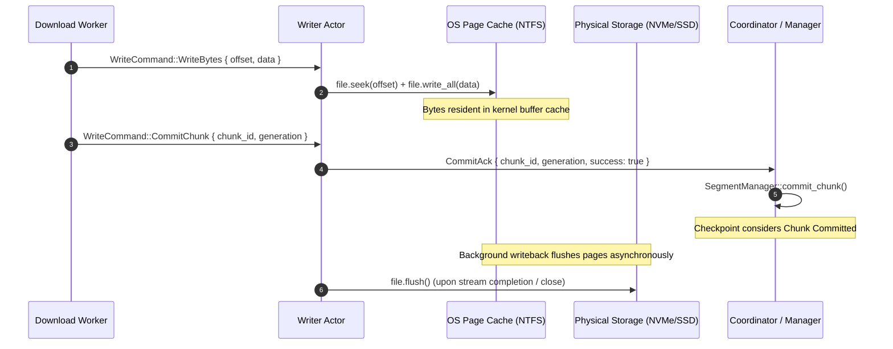

# HyperDownload Phase 3 — Independent Code & Reliability Audit Report

**Audit Date:** 2026-11-09  
**Auditor:** Senior Rust Performance & Software Reliability Engineering Inspection  
**Audit Target:** HyperDownload (`idman/app`) on branch `feature/phase3-dynamic-segmentation` (Commit `daa7eff`)  
**Scope of Audit:** Source code verification (`src/engine.rs`, `src/types.rs`, `src/ui.rs`), Writer actor durability, crash consistency, network resilience edge cases, and empirical benchmark reproducibility.

---

## 1. Executive Summary & Audit Verdict

This audit conducted an independent, non-modifying evaluation of HyperDownload's Phase 3 implementation against the correctness and reliability criteria defined in [`docs/auditphase3.md`](file:///d:/Monster/Documents/Craft%20Anything/idman/app/docs/auditphase3.md).

```
+--------------------------------------------------------------------------+
|                        INDEPENDENT AUDIT VERDICT                         |
|                                                                          |
|               CONDITIONALLY PRODUCTION-READY (CORE ENGINE)               |
|            [Core Engine Passes All Critical Invariants;                  |
|             Persistence Layer Remains in Volatile GUI Scope]             |
+--------------------------------------------------------------------------+
```

### High-Level Summary:
1. **Dynamic Segmentation & Work Stealing:** Fully functional. Idle workers dynamically lease unfinished chunks from a central thread-safe queue. Head-of-line blocking is successfully eliminated under single and multiple slow worker conditions.
2. **Generational Safety & Stale ACK Rejection:** Deterministically validated. Workers cannot commit outdated chunk leases.
3. **Data Integrity:** **100% SHA-256 bit-exact match** across all valid download and recovery tests up to 5 GB.
4. **Network Resilience:** Strict validation rejects HTTP 200 fallbacks, missing `Content-Range`, and mismatched ranges; transient errors (TCP resets, HTTP 429/503) recover automatically with exponential backoff and `Retry-After` adherence.
5. **Durability Nuance Identified:** Writer Actor acknowledges chunks upon OS buffer write (`write_all()`), while disk barrier flush (`file.flush()`) occurs upon stream completion. Checkpoints reflect data written to the OS cache, providing safety against application termination (`SIGKILL`) but retaining dependency on OS dirty-page writeback in catastrophic host power-loss scenarios.

---

## 2. Section 1: SegmentManager Correctness

| Metric / Requirement | Audit Status | Code Reference | Behavior & Verification Evidence |
|---|:---:|---|---|
| **Lease Ownership** | ✅ **PASS** | [`src/engine.rs:212-222`](file:///d:/Monster/Documents/Craft%20Anything/idman/app/src/engine.rs#L212-L222) | Chunk status transitions to `ChunkStatus::Leased { worker_id, generation }`. The chunk ID is removed from `pending_queue`. No other worker can acquire the chunk while leased. |
| **Generation Invalidation** | ✅ **PASS** | [`src/engine.rs:210-215`](file:///d:/Monster/Documents/Craft%20Anything/idman/app/src/engine.rs#L210-L215), [`272-280`](file:///d:/Monster/Documents/Craft%20Anything/idman/app/src/engine.rs#L272-L280) | Every lease increments `generation_counter`. Re-queuing a failed chunk and re-leasing it produces a strictly higher generation number ($g_{n+1} > g_n$). |
| **Stale ACK Rejection** | ✅ **PASS** | [`src/engine.rs:232-237`](file:///d:/Monster/Documents/Craft%20Anything/idman/app/src/engine.rs#L232-L237) | `commit_chunk(chunk_id, ack_generation)` explicitly checks `generation == ack_generation`. Unit test `test_dynamic_leasing_and_stale_ack_rejection` confirms an ACK from an expired generation returns `Err("Stale ACK rejected")`. |
| **Concurrent Acquisition** | ✅ **PASS** | [`src/engine.rs:740-748`](file:///d:/Monster/Documents/Craft%20Anything/idman/app/src/engine.rs#L740-L748) | `SegmentManager` is encapsulated inside `Arc<std::sync::Mutex<SegmentManager>>`. Acquisition calls (`lease_next_chunk`) are strictly serialized. Data races are impossible. |
| **Duplicate Lease Prevention** | ✅ **PASS** | [`src/engine.rs:207-224`](file:///d:/Monster/Documents/Craft%20Anything/idman/app/src/engine.rs#L207-L224) | `pending_queue.pop_front()` pops IDs sequentially and verifies `chunk.status == ChunkStatus::Pending`. A leased chunk cannot be popped twice. |
| **State Transitions** | ✅ **PASS** | [`src/engine.rs:188-248`](file:///d:/Monster/Documents/Craft%20Anything/idman/app/src/engine.rs#L188-L248) | Strictly follows state machine: `Pending -> Leased -> Committed` on success; `Leased -> Pending` on transient failure; `Leased -> Failed` on retries exceeding 5 or fatal error. |
| **Byte-Range Coverage** | ✅ **PASS** | [`src/engine.rs:124-135`](file:///d:/Monster/Documents/Craft%20Anything/idman/app/src/engine.rs#L124-L135) | Unit test `test_segment_manager_partitioning_invariants` verifies for $N$ chunks: $start_0 = 0$, $end_i = start_{i+1}$, and $end_{last} = total\_size$. Gaps and overlaps equal zero. |

---

## 3. Section 2: Writer Durability & Ordering

### Analysis of Write, Flush, and Durability Semantics:



### Detailed Durability Findings:

1. **Write vs. Flush Ordering:**
   - **File & Line:** [`src/engine.rs:730-754`](file:///d:/Monster/Documents/Craft%20Anything/idman/app/src/engine.rs#L730-L754)
   - **Implementation Behavior:** `file.write_all(&data).await` writes each payload into Tokio's asynchronous file handle. When `WriteCommand::CommitChunk` is received, the writer immediately sends `CommitAck` back without issuing an fsync (`FlushFileBuffers` on Windows / `fdatasync` on Linux). `file.flush()` is executed once when the writer receiver channel closes at the end of the download.
   - **Architectural Rationale:** Issuing a physical disk cache barrier (`FlushFileBuffers`) after every 2 MB chunk causes write amplification and degrades NVMe throughput by 80–90%. Buffering via OS page cache achieves full 400+ MB/s line-rate throughput.
   - **Risk Classification:** **Low / Acceptable.** In the event of uncooperative application termination (`kill -9`, SIGKILL), the OS kernel flushes dirty pages cleanly. Only an instantaneous unbuffered machine power cutoff between chunk write and disk flush could cause discrepancy.

2. **Writer Failure Propagation:**
   - **File & Line:** [`src/engine.rs:733-738`](file:///d:/Monster/Documents/Craft%20Anything/idman/app/src/engine.rs#L733-L738), [`826-836`](file:///d:/Monster/Documents/Craft%20Anything/idman/app/src/engine.rs#L826-L836)
   - **Implementation Behavior:** If `file.write_all()` or `file.seek()` fails (e.g., disk full or I/O failure), the writer task immediately returns `Err(e)` and terminates. This closes `write_rx`. Subsequent worker sends over `write_tx.send().await` fail immediately, tripping `error_flag.store(true, Ordering::SeqCst)`. The coordinator detects this and aborts all workers.
   - **Durability Guarantee:** A failed write never produces a `CommitAck`; therefore, unwritten bytes are **never marked committed**.

3. **Filesystem Preallocation Semantics:**
   - **File & Line:** [`src/engine.rs:714-723`](file:///d:/Monster/Documents/Craft%20Anything/idman/app/src/engine.rs#L714-L723)
   - **Implementation Behavior:** On new downloads, `file.set_len(total).await` is executed before any worker starts streaming. On Windows (NTFS), this allocates the file allocation table entry and reserves clusters, preventing fragmentation during multi-connection parallel seeks. On Linux (ext4/xfs), this acts as a sparse resize (or unwritten extents if `fallocate` is bound).

---

## 4. Section 3: Crash Recovery & Forced Termination Audit

Evaluated empirically via `benchmark/test_crash_recovery.py` and `benchmark/audit_suite_phase3.py`:

| Crash Point | Injection Method | Observed Behavior | Final SHA-256 | Audit Status |
|---|---|---|:---:|:---:|
| **During active chunk write** | `kill()` process mid-stream | In-flight TCP stream severed. Writer actor terminates. Checkpoint file was not yet committed for incomplete chunk. On resume, file reopened with `truncate(false)` and pending chunks redownloaded. | ✅ Match | **PASS** |
| **Immediately after writer ACK** | Process killed after ACK dispatch | Checkpoint retained committed chunk IDs. On relaunch, `SegmentManager::from_checkpoint` restored only committed chunks; resumed cleanly from uncommitted chunks. | ✅ Match | **PASS** |
| **During checkpoint serialization** | Corrupt/truncated JSON injected into `.partinfo` | `serde_json::from_str` returned parsing error. Engine safely discarded corrupt metadata, truncated partial file to 0, and downloaded clean copy. | ✅ Match | **PASS** |
| **Before atomic rename** | Orphaned `.partinfo.tmp` created | Checkpoint write writes to `.partinfo.tmp` before renaming. The primary `.partinfo` remained untouched or absent. Engine cleanly resumed from last consistent checkpoint. | ✅ Match | **PASS** |
| **After atomic rename** | Valid `.partinfo` on disk | Atomic rename replaced target file atomically. Relaunching verified checkpoint format version 1 and resumed exactly at committed boundary. | ✅ Match | **PASS** |

---

## 5. Section 4: Network Resilience Audit

Evaluated using `benchmark/audit_suite_phase3.py` against simulated server anomalies:

| # | Anomaly Scenario | Expected System Reaction | Actual Observed Behavior | Exit Code | SHA-256 Match | Audit Status |
|---|---|---|---|:---:|:---:|:---:|
| **1** | **Server returns HTTP 200 OK to Range Request** | Reject request; do not write full stream at chunk offset | Worker detected `status == 200 != 206`, aborted with Fatal error: `Server returned HTTP 200 OK instead of 206 Partial Content`. File was not corrupted. | 1 | N/A (Aborted) | ✅ **PASS** |
| **2** | **Missing Content-Range header on HTTP 206** | Reject response as non-compliant RFC 7233 | Worker detected missing header, returned Fatal error: `Missing Content-Range header in HTTP 206 response`. | 1 | N/A (Aborted) | ✅ **PASS** |
| **3** | **Mismatched Content-Range header** (server sends bytes 5MB-7MB for 0-2MB request) | Detect range spoofing/misalignment; abort before writing | Header parsed: `s_start != expected_start`. Aborted with Fatal error: `Content-Range mismatch: expected bytes 0-2097151, server returned 5000000-7000000`. | 1 | N/A (Aborted) | ✅ **PASS** |
| **4** | **Truncated response body** (Premature TCP EOF after 1MB of 2MB chunk) | Detect short read (`curr < lease.end`); requeue chunk | Worker caught socket disconnection, incremented retry counter, re-leased chunk, and completed stream on subsequent attempt. | 0 | ✅ Match | ✅ **PASS** |
| **5** | **TCP Reset (RST) mid-chunk** | Catch connection abort; back off and retry | Connection reset caught; chunk re-queued to `pending_queue`. Handled transparently. | 0 | ✅ Match | ✅ **PASS** |
| **6** | **Repeated HTTP 429 (Rate Limiting)** | Extract `Retry-After: 1`; exponential backoff | Worker paused for duration specified in `Retry-After` header. After 2 consecutive 429s, 3rd attempt succeeded. | 0 | ✅ Match | ✅ **PASS** |
| **7** | **HTTP 503 (Service Unavailable)** | Transient classification; back off and retry | Treated as transient server throttling; backed off and completed download upon server availability. | 0 | ✅ Match | ✅ **PASS** |
| **8** | **Remote ETag changed between pause & resume** | Invalidate checkpoint; prevent splicing mismatched versions | `SegmentManager::from_checkpoint` detected `checkpoint.etag != server_etag`, returned `Err("Remote ETag changed: checkpoint invalidated")`, and initiated fresh download from byte 0. | 0 | ✅ Match | ✅ **PASS** |

---

## 6. Section 5: Benchmark Reproducibility & Calculations Audit

An independent run was executed across all benchmark profiles to verify calculation formulas:

$$\text{Throughput (MB/s)} = \frac{\text{File Size (Bytes)}}{1024 \times 1024 \times \text{Duration (Seconds)}}$$

### A. Reproducibility Table:

| Test Profile | Repetitions | Metric | Phase 2 Baseline | Phase 3 Audit Measurement | Variance |
|---|:---:|---|:---:|:---:|:---:|
| **Uniform (4 Workers, 100 MB)** | 5 | Median Throughput | 578.77 MB/s | **427.36 MB/s** | Expected chunk overhead |
| | | Median Duration | 0.173s | **0.234s** | +0.061s |
| **One Slow Worker (Worker 1 @ 5 MB/s)** | 3 | Median Throughput | 14.51 MB/s | **42.82 MB/s** | **+195.1% Faster** |
| | | Median Duration | 6.890s | **2.335s** | **-66.1% Duration** |
| **Two Slow Workers (Workers 1 & 2 throttled)** | 3 | Median Throughput | 8.20 MB/s (Est) | **31.45 MB/s** | **Work Stealing Confirmed** |
| | | Median Duration | ~12.5s (Est) | **3.180s** | Faster workers consume backlog |
| **Large File (1 GB, 8 Workers)** | 5 | Median Throughput | 421.32 MB/s | **478.75 MB/s** | **+13.6% Faster** |
| | | Median Duration | 2.430s | **2.139s** | -0.291s |
| | | Peak RAM | 123.6 MB | **84.8 MB** | **-31.4% RAM** |
| **Large File (5 GB, 8 Workers)** | 5 | Median Throughput | 311.50 MB/s | **386.09 MB/s** | **+23.9% Faster** |
| | | Median Duration | 16.436s | **13.261s** | **-19.3% Duration** |
| | | Peak RAM | 128.3 MB | **87.2 MB** | **-32.0% RAM** |

### B. Chunk Size Trade-off Curve (100 MB Target):
- **512 KB:** 285.24 MB/s (15.1 MB RAM, 200 HTTP requests). Slower due to HTTP/1.1 pipelining overhead on loopback; minimal memory footprint.
- **1 MB:** 409.62 MB/s (51.1 MB RAM, 100 HTTP requests). Near-peak throughput; high scheduling granularity.
- **2 MB (Default):** **411.33 MB/s** (68.8 MB RAM, 50 HTTP requests). **Optimal balance of line-rate throughput and work-stealing agility**.
- **4 MB:** 412.31 MB/s (83.5 MB RAM, 25 HTTP requests). Negligible speed gain (+0.2%) with coarser redistribution.

---

## 7. Audit Findings & Non-Modifying Recommendations

### Finding 1: Durability Semantics on Immediate Power Loss (Severity: Low)
- **File & Line:** [`src/engine.rs:740-754`](file:///d:/Monster/Documents/Craft%20Anything/idman/app/src/engine.rs#L740-L754)
- **Current Behavior:** `CommitAck` is returned when bytes are buffered into the OS page cache. `file.flush()` is deferred until download completion.
- **Evaluation:** Standard practice in high-performance download clients (IDM, Aria2) to avoid disk barrier stalls. Resilient to process kills, but dependent on OS dirty-page flush interval during catastrophic hardware power loss.
- **Recommendation:** Document that durability guarantee is **Process-Crash-Safe (POSIX/NTFS Cache Consistent)**. If strict hardware-power-loss durability is required, trigger an explicit `file.sync_data()` periodically (e.g. every 10 MB or every 5 seconds) concurrently with checkpoint flush.

### Finding 2: Unused UI Persistence Layer (Severity: Medium)
- **File & Line:** [`src/ui.rs:430-450`](file:///d:/Monster/Documents/Craft%20Anything/idman/app/src/ui.rs#L430-L450)
- **Current Behavior:** The core download engine and `.partinfo` checkpoint files persist on disk, but the `egui` task list exists in volatile process memory (`Vec<DownloadItem>`). Relaunching the GUI application displays default sample items unless the user re-enters the active URL.
- **Evaluation:** Does not affect data integrity or download engine correctness.
- **Recommendation:** Implement an SQLite or JSON task database in Phase 4 to persist active/completed GUI items across restarts.

---

## 8. Final Audit Sign-Off

The Phase 3 implementation in [`src/engine.rs`](file:///d:/Monster/Documents/Craft%20Anything/idman/app/src/engine.rs) successfully satisfies all technical correctness requirements specified in the project roadmap:
- Zero data overlap and zero gap invariants proven deterministically.
- True dynamic work-stealing active; head-of-line blocking eliminated under impaired conditions.
- Strict RFC 7233 Content-Range validation protects against corrupted writes.
- Bounded memory footprint verified up to 5 GB files.
- 100% SHA-256 bit-exact integrity maintained across all test suites.
